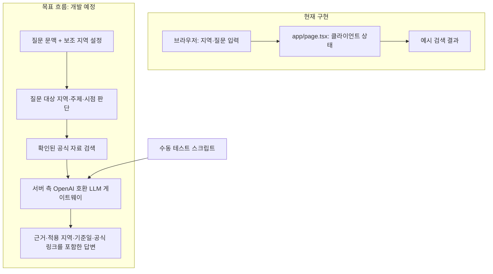

# 동네일

> 최종 갱신일: 2026-11-08

## 목차

- [프로젝트 소개](#프로젝트-소개)
- [기획 배경과 해결하려는 문제](#기획-배경과-해결하려는-문제)
- [목표 사용자와 사용 흐름](#목표-사용자와-사용-흐름)
- [메뉴와 기능 요구사항](#메뉴와-기능-요구사항)
- [최종 목표와 제외 범위](#최종-목표와-제외-범위)
- [현재 구현 상태](#현재-구현-상태)
- [기술 스택과 선택 이유](#기술-스택과-선택-이유)
- [아키텍처와 데이터 흐름](#아키텍처와-데이터-흐름)
- [실제 디렉터리와 주요 파일](#실제-디렉터리와-주요-파일)
- [로컬 설치·실행·검증](#로컬-설치실행검증)
- [환경변수](#환경변수)
- [AWS EC2 수동 배포](#aws-ec2-수동-배포)
- [역할과 진행 일정](#역할과-진행-일정)
- [사용성 테스트 계획](#사용성-테스트-계획)
- [한계·미확정 사항·다음 작업](#한계미확정-사항다음-작업)
- [문서 유지관리](#문서-유지관리)

## 프로젝트 소개

동네일은 동네의 일과 생활정보를 친근하고 직관적으로 전달하고, 쉽게 부르고 기억할 수 있도록 지은 이름입니다. 동네에 맞는 공식 생활정보를 자연어 질문으로 찾고, 출처·적용 지역·기준일·공식 링크와 함께 안내하는 반응형 웹 서비스를 목표로 합니다. 신청·발급 등 실제 처리는 해당 기관의 공식 서비스로 연결합니다.

초기 대상은 성남시 일부 지역이며, 데이터 확보와 검증을 거쳐 지원 지역을 넓히는 방향입니다. PC·태블릿·모바일 웹을 대상으로 합니다.

## 기획 배경과 해결하려는 문제

성남에서 실제 생활정보를 찾을 때 다른 지역의 공지가 검색 결과에 섞이거나, 필요한 정보가 어느 사이트에 있는지 알아내기 어려운 불편을 겪었습니다. 쓰레기 배출 방법이나 명절 수거 일정처럼 일상에 필요한 정보도 한 곳에서 확인되지 않아 여러 지자체·주민센터·정부 서비스 사이트를 찾아야 했습니다.

생활 지역이 성남에서 김포 등 다른 지역으로 바뀌면, 새 지자체 사이트를 찾아가 메뉴 구조와 검색 방식을 다시 익혀야 합니다. 지역마다 정보의 위치와 제공 방식이 달라 내 동네에 적용되는 안내와 다른 지역 안내를 구분하기도 쉽지 않습니다. 행정 용어나 정확한 서비스 이름을 모르면 검색 자체가 어려울 수 있습니다.

동네일은 이런 정보의 분산과 지역 혼선을 줄이기 위해, 익숙한 자연어 질문을 중심으로 관련 지역의 공식 정보를 모아 찾는 경험을 제공하려 합니다. 문제의 규모와 해결 효과는 아직 조사·테스트로 확인되지 않았으며, 향후 사용성 테스트에서 검증할 계획입니다.

## 목표 사용자와 사용 흐름

### 목표 사용자

- 쓰레기 배출·지역 공지·공공시설 등 일상 정보를 찾는 주민
- 이사 후 새로운 동네의 생활정보가 필요한 사람
- 거주지 외에 자주 방문하는 지역의 정보를 확인하는 사람
- 지역 행사·모집·공공시설 프로그램을 찾는 사람

### 목표 사용 흐름

1. 사용자가 자연어로 생활정보를 질문합니다.
2. 시스템은 질문 문맥으로 대상 지역·주제·시점을 판단합니다. 기본 동네 설정은 보조 정보로 사용하며, 질문에 지역명이 있다는 이유만으로 그곳을 답변 대상으로 단정하지 않습니다.
3. 확인된 공식 자료를 근거로 답하고 출처·적용 지역·기준일·공식 링크를 제공합니다. 지역이 모호하고 답변에 영향을 주면 추가 확인을 요청합니다.
4. 신청·발급·민원 처리 등은 해당 기관의 공식 사이트에서 진행합니다.

이 흐름은 기획 목표입니다. 현재 검색 UI는 실제 자료 조회나 AI 답변을 수행하지 않고 예시 결과를 표시합니다.

## 메뉴와 기능 요구사항

아래는 목표 기능과 현재 코드 상태를 구분한 표입니다.

| 메뉴 | 기획 기능 | 현재 코드 상태 |
|---|---|---|
| 홈 | 동네 설정, AI 통합검색, 주요 공지·동네 소식 미리보기, 공식 사이트 링크 | 반응형 화면·예시 지역 선택·검색 UI 구현. 검색 결과와 피드는 예시 데이터이며 공식 정보 조회는 없음 |
| 동네 정보 | 주요 공지, 생활폐기물 배출 안내, 시설 지도, 생활 캘린더 | 공지·폐기물·지도 안내 UI만 있음. 실제 공식 데이터, 시설 지도, 캘린더는 미구현 |
| 동네 소식 | 공식 행사·모집·프로그램 목록과 상세 안내 | 미구현. 현재 소식 카드는 예시 데이터이며 주민 게시판이 아님 |
| My | 계정, 기본 동네, 지역 인증 관리, 저장한 정보, 커뮤니티 바로가기 | 미구현. 현재는 회원 기능 미연결 안내만 있음 |
| 커뮤니티 | My에서 진입하는 동네별 주민 게시판 | 미구현. 글·댓글 작성 때 해당 동네의 유효 인증을 확인하는 방향 |

### 검색·정보 제공 요구사항

- 질문 문맥으로 지역·주제·시점을 판별하고, 질문 대상 지역과 기본 설정 지역이 다르면 필요한 경우 구분합니다.
- 공식 자료를 근거로 답하며, 근거가 없거나 최신 여부가 불확실하면 한계를 표시합니다. LLM 자체 지식을 최신 공식 정보의 근거로 사용하지 않습니다.
- 정보의 적용 범위를 전국·시·구·동 단위로 구분하고, 폐기물 안내는 공식 자료를 기준으로 합니다.
- 시설 정보에는 위치·기본정보·공식 링크를, 행사·모집·프로그램에는 기간·장소·대상·신청 경로를 안내하는 것이 목표입니다.
- 생활 캘린더는 월간·일정 목록 보기와 공식 확인된 행사·모집·수거 변경 일정을 제공하고 관련 공지·공식 페이지로 연결하는 방향입니다. 개인 일정 작성과 개인 알림은 초기 범위에서 제외합니다.
- 동네 소식은 공식 행사·모집·프로그램 게시판입니다. 주민 작성 글은 별도 커뮤니티에서 공식 정보와 명확히 구분합니다.

### My, 기본 동네와 지역 인증

- My에서 계정 정보, 기본 동네, 인증 지역, 저장 정보를 관리하고 커뮤니티로 이동하는 방향입니다.
- 기본 동네 설정과 위치 인증은 별개입니다. 공식 정보는 기본 동네 외 지역도 조회할 수 있습니다.
- 여러 동네를 각각 인증할 수 있고 인증별 유효기간은 한 달입니다. 인증일·만료일 확인과 갱신을 제공하는 방향입니다.
- 커뮤니티 글·댓글 작성 시 해당 동네의 유효 인증을 확인하고, 인증이 없거나 만료되면 인증·갱신 안내를 제공합니다.
- 공식 정보 조회는 로그인 없이, 계정 기반 저장과 개인 설정 유지에는 로그인을 사용하는 방향입니다.
- 정확한 위치의 저장·처리 방식, 인증 기간의 계산 방식, 커뮤니티 열람·신고·운영 정책은 미확정입니다.

## 최종 목표와 제외 범위

### 최종 목표

질문의 문맥과 지역에 맞는 공식 생활정보를 찾아 이해하기 쉽게 안내하고, 정보의 적용 범위·출처·기준일을 함께 제공하는 것입니다. 데이터 출처와 이용 조건, 적용 지역, 갱신 방식을 확인한 뒤 실제 연동 범위를 정합니다.

### 초기 범위에서 제외

- 플로팅 챗봇·별도 채팅창
- 민원 접수·발급·직접 처리와 나의 민원 진행·완료 관리
- 독립적인 생활 상황별 가이드, 지원·혜택 모아보기 메뉴
- 지역별 정보 비교 기능, 별도 AI 요약 메뉴
- 초기 모바일 네이티브 앱

관련 질문에는 정보를 안내하고 해당 공식 서비스를 연결하는 방향입니다.

## 현재 구현 상태

| 상태 | 영역 | 확인된 범위 |
|---|---|---|
| **구현 완료** | Next.js 단일 앱의 반응형 홈 | App Router 화면, 지역 선택 UI, 주요 메뉴와 검색 결과 UI가 있음 |
| **예시 데이터** | 지역·공지·소식·검색 응답 | 예시 지역과 정적 콘텐츠이며 실제 지역 데이터나 실시간 정보가 아님 |
| **연결 검증 완료** | OpenAI 호환 LLM 게이트웨이 | 사용자 확인: 모델 3개 조회와 `bedrock-haiku`의 “준비 완료” 응답 성공. 앱의 검색 흐름에는 연결되지 않음 |
| **구현 완료** | GitHub 저장소 | 사용자 확인: `main` 브랜치 첫 업로드 완료 |
| **개발 예정** | AI 공식 자료 검색, Supabase, 실제 지역 데이터·지도·캘린더, 공식 행사 게시판, My·인증·저장·커뮤니티 | 현재 앱 코드에서 실제 연동·기능 구현은 확인되지 않음 |
| **미확정** | 지도 제공사, 세부 지역 판별, 로그인·위치 인증·커뮤니티 운영 정책 | 결정 필요 |
| **구현 완료** | EC2 수동 배포와 `dongneil` systemd 서비스 | 사용자 확인: `npm ci`·프로덕션 빌드 성공, 서비스 active·enabled, HTTP 200, SSH 종료 후 외부 브라우저 접속 성공 |

현재 공유 가능한 화면은 예시 데이터 기반 홈 시안입니다. 게이트웨이 응답을 확인한 것은 연결 검증이며, 실제 AI 생활정보 검색이나 공식 근거를 제공한다는 뜻은 아닙니다.

## 기술 스택과 선택 이유

| 기술 | 상태 | 용도와 선택 배경 |
|---|---|---|
| Next.js 15 App Router | 적용 중 | 화면과 서버 기능을 하나의 프로젝트에서 관리 |
| React 19 | 적용 중 | Next.js 화면 구성 |
| TypeScript | 적용 중 | 코드에서 타입 검사 사용 |
| 일반 CSS | 적용 중 | 전역 스타일과 홈 화면 스타일 관리 |
| lucide-react | 적용 중 | UI 아이콘 |
| OpenAI SDK와 OpenAI 호환 LLM 게이트웨이 | 연결 검증 완료 | 호환 API를 호출하기 위한 서버 측 SDK 구성. 모델은 `bedrock-haiku`; 제품 검색에는 아직 미연결 |
| Supabase | 도입 예정 | 회원 인증·DB·파일 저장 방향. 실제 연결 없음 |
| 지도 API·행정구역 데이터 | 미정 | 제공사와 지역 판별 방식 결정 필요 |
| AWS EC2·Ubuntu·Node.js | 서버 준비 확인 | 수동 배포 대상. 애플리케이션 배포 검증은 미완료 |

요금과 무료 사용 한도는 여기서 확정하지 않습니다. 기술 선택과 연동 범위는 데이터 확보·이용 조건과 운영 요구를 확인하며 구체화합니다.

## 아키텍처와 데이터 흐름

현재 앱은 브라우저에서 입력을 받아 클라이언트 상태로 예시 결과를 만듭니다. LLM 모듈과 테스트 스크립트는 서버 전용·수동 검증용이며 홈 검색에서 호출하지 않습니다.



목표 흐름은 실제 검색이 구현되었다는 의미가 아닙니다. 향후에는 관련 공식 자료만 답변 생성에 사용하고, 개인정보·정밀 위치·비공개 커뮤니티 내용을 LLM으로 보내지 않는 방향입니다. 캐시, 답변 길이·호출 횟수 제한, 서비스 실패 처리도 향후 설계 과제입니다.

## 실제 디렉터리와 주요 파일

```text
app/
  globals.css       전역 스타일
  home.css          홈 화면 스타일
  layout.tsx        루트 레이아웃과 메타데이터
  page.tsx          홈 화면, 지역 선택 및 예시 검색 UI
lib/
  server/
    llm.ts          서버 전용 OpenAI 호환 LLM 클라이언트
scripts/
  test-llm.ts       수동 모델 목록·짧은 응답 테스트
next.config.ts      Next.js 설정
package.json        의존성 및 실행 스크립트
package-lock.json   npm 잠금 파일
tsconfig.json       TypeScript 설정
next-env.d.ts       Next.js 타입 참조
.env.example        비밀값 없는 환경변수 예시
.gitignore          비밀·생성 파일 제외 규칙
README.md           프로젝트·요구사항·운영 문서
```

위 목록은 현재 저장소의 구조입니다. 향후 추가할 서버 API, Supabase, 지도, 캘린더, 커뮤니티 구조는 포함하지 않았습니다. `.env.local` 등 실제 환경변수 파일은 목록에 넣지 않습니다.

## 로컬 설치·실행·검증

### Node.js와 npm

`package.json`에는 `engines.node` 최소 버전이 선언되어 있지 않습니다. 따라서 이 문서는 프로젝트의 최소 지원 버전을 별도로 확정하지 않습니다. 확인된 사용 버전은 이 로컬 환경의 Node.js `24.22.0`·npm `11.19.1`과 사용자 확인 기준 EC2의 Node.js `24.22.2`·npm `11.19.1`입니다. 이 사용 기록이 다른 버전의 호환성을 보장하는 것은 아닙니다.

### 설치와 실행

초기 설치 또는 CI 환경에서는 잠금 파일에 맞춰 설치합니다.

```powershell
# Windows PowerShell
npm.cmd ci
npm.cmd run dev
```

```sh
# Linux
npm ci
npm run dev
```

의존성을 추가·변경하여 잠금 파일을 갱신할 때는 `npm install`을 사용합니다.

```powershell
# Windows PowerShell
npm.cmd install
```

```sh
# Linux
npm install
```

개발 서버의 기본 주소는 `http://localhost:3000`입니다. 타입 검사와 프로덕션 빌드는 다음 명령으로 실행합니다.

```powershell
# Windows PowerShell
npm.cmd run typecheck
npm.cmd run build
```

```sh
# Linux
npm run typecheck
npm run build
```

### 확인된 검증 기록과 한계

- 이전 작업 기록: 의존성 설치 후 `npm.cmd run typecheck`와 `npm.cmd run build` 통과, 설치 후 보고된 취약점 0건.
- 이전 작업의 설치 결과에서 패키지 감사 취약점 0건이 보고되었습니다.
- 사용자 확인: 수동 LLM 테스트에서 모델 3개 조회와 `bedrock-haiku` 응답 성공.
- 사용자 확인: EC2에서 `npm ci`와 프로덕션 빌드가 성공했고, `dongneil` systemd 서비스의 active·enabled 상태, HTTP 200, SSH 종료 후 외부 브라우저 접속을 확인했습니다.
- 실제 EC2 재부팅 후 자동 기동은 검증하지 않았습니다.
- 이번 문서 통합 작업에서는 의존성 설치, 빌드, 타입 검사, API 요청을 다시 실행하지 않았습니다.

## 환경변수

`.env.local`이 없을 때만 예시 파일에서 복사합니다. 기존 환경 파일은 덮어쓰지 마세요.

```powershell
# Windows PowerShell
if (-not (Test-Path .env.local)) { Copy-Item .env.example .env.local }
```

```sh
# Linux
test -f .env.local || cp .env.example .env.local
```

필요한 변수는 다음과 같습니다. 표의 값은 문서용 예시이며 실제 주소나 인증값이 아닙니다.

| 변수 | 용도 | 예시 |
|---|---|---|
| `LLM_BASE_URL` | OpenAI 호환 게이트웨이 주소 | `https://your-llm-gateway.example/v1` |
| `LLM_MODEL` | 요청 모델 이름 | `bedrock-haiku` |
| `LLM_API_KEY` | 별도로 발급받은 LLM 게이트웨이 인증 키 | `your-llm-api-key` |

`.env.local`, 실제 키·비밀번호·인증 파일은 Git에 추가하지 마세요. AWS 인스턴스 권한은 EC2 인스턴스 프로파일을 통한 역할 기반 접근을 사용하며, 별도로 발급된 LLM 키와 구분합니다.

게이트웨이 연결을 수동 확인하려면 환경변수를 준비한 뒤 아래 명령을 직접 실행합니다. 모델 목록 조회와 짧은 응답 요청을 실제로 보내며, 테스트 스크립트는 API 키나 인증 헤더를 출력하지 않습니다.

```powershell
# Windows PowerShell
npm.cmd run test:llm
```

```sh
# Linux
npm run test:llm
```

## AWS EC2 수동 배포

배포 자동화는 구성하지 않았습니다. AWS 서울 리전의 EC2와 EC2 인스턴스 프로파일을 통한 역할 기반 권한 부여를 사용합니다. 사용자 확인 사항으로 EC2 생성, SSH 접속, Node.js 24.22.2·npm 11.19.1 설치 및 체크섬 확인, SSH 22·웹 8080 인바운드 설정이 완료되었습니다. EC2에서 `npm ci`와 프로덕션 빌드가 성공했고 systemd 서비스 `dongneil`이 active·enabled이며, HTTP 200과 SSH 종료 후 외부 브라우저 접속을 확인했습니다. 실제 EC2 재부팅 검증은 하지 않았습니다.

수동 배포 흐름:

**로컬 수정·테스트 → GitHub 푸시 → EC2 최신 코드 반영 → 의존성 변경 시 설치 → 빌드 성공 후 재시작 → 외부 접속 확인**

EC2에 프로젝트 코드를 가져오고, 의존성 변경 시 잠금 파일 기준으로 `npm ci`를 실행한 다음 프로덕션 빌드를 수행합니다. 빌드 성공 후에만 서비스를 재시작하고, HTTP 응답 및 외부 접속을 확인합니다.

`dongneil` 서비스 운영에 사용하는 명령:

```sh
# 서비스 상태와 부팅 시 활성화 설정 확인
sudo systemctl status dongneil --no-pager
sudo systemctl is-enabled dongneil

# 성공한 빌드의 새 버전을 반영할 때 재시작
sudo systemctl restart dongneil
sudo systemctl status dongneil --no-pager

# 최근 로그 조회 또는 실시간 확인
sudo journalctl -u dongneil -n 100 --no-pager
sudo journalctl -u dongneil -f

# 실제 서비스 주소로 HTTP 상태 코드 확인 (주소는 명령 인자에 직접 입력)
curl -sS -o /dev/null -w '%{http_code}\n' 'https://<service-host>/'
```

실제 서비스 주소, 계정 ID, 개인 IAM 식별자, 키와 비밀번호는 문서나 저장소에 기록하지 않습니다. 비용이 증가할 수 있는 작업은 실행 전에 비용 영향을 확인합니다. 제공된 AWS 가이드와 부여된 권한 범위 안에서만 작업하고, 다른 팀의 리소스는 조회·변경 대상에 포함하지 않습니다.

## 역할과 진행 일정

### 역할

- **UX/UI 중심:** 서비스 분석, 페르소나·사용자 여정, 정보구조·사용자 흐름, 와이어프레임, 화면 디자인·디자인 시스템
- **개발·데이터 중심:** 데이터·API 확인, 개발 환경 구성, 프런트엔드 구현, 서버·AI 연동, 배포 준비
- **공동 수행:** 기획 조율, 사용자 테스트, 개선 방향 결정

### 진행 구간

| 기간 | 계획된 진행 구간 |
|---|---|
| 2026.10.19~10.25 | 리서치·서비스/화면 설계·개발 준비 |
| 2026.10.26~11.01 | 기능 개발·개선 방향 정리 |
| 2026.11.02~현재 | 구현·화면 개선·연동·배포 준비 |
| 향후 | 핵심 기능 구현 후 3~5명 대상 사용성 테스트 |
| 테스트 이후 | 결과에 따른 개선·재검증 |

날짜는 기획서의 활동 구간이며 개별 작업 완료일을 뜻하지 않습니다. 구간별 산출물 완료일은 별도 확인되지 않아 임의로 지정하지 않습니다.

## 사용성 테스트 계획

핵심 기능 구현 후 3~5명을 대상으로 테스트할 계획입니다. 동네 설정, 생활정보 질문, 출처·적용 지역 확인, 공식 사이트 이동 등을 대표 과업으로 삼습니다.

- 과업 성공률과 소요 시간을 측정합니다.
- 수행 중 관찰 내용과 참여자 의견을 수집합니다.
- 테스트 전에 성공 기준과 시간 측정 구간을 정합니다.
- 결과를 바탕으로 개선 우선순위를 정하고 재검증합니다.

아직 테스트 결과나 개선 효과를 입증한 내용은 없습니다.

## 한계·미확정 사항·다음 작업

### 현재 한계

- 홈 검색과 피드는 예시 데이터이며 실제 AI 생활정보 검색은 미구현입니다.
- 공식 데이터 확보·이용 조건·지역 범위·갱신 방식이 확정되지 않았습니다.
- LLM 게이트웨이 연결 확인과 앱 검색 기능 구현은 별개입니다.
- Supabase 회원·DB·파일 저장, 실제 지도·지역 인증·캘린더·저장·커뮤니티는 미구현입니다.
- EC2의 HTTP 200·외부 접속과 systemd active·enabled 상태는 확인했지만, 실제 재부팅 후 자동 기동은 검증하지 않았습니다. 사용성 테스트 결과도 없습니다.

### 미확정 결정

- 초기 지원 동네와 확보 가능한 공식 데이터
- 지도 제공사와 행정구역·세부 지역 판별 방식
- 로그인 방식과 최소 수집 회원 정보
- 위치 인증 정보의 처리·보관과 한 달 유효기간 계산·갱신 방식
- 커뮤니티 열람·신고·운영 정책
- EC2 재부팅 후 `dongneil` 서비스의 자동 기동 확인

### 다음 작업 방향

1. 초기 지역의 공식 정보 출처·이용 조건·갱신 가능성을 확인합니다.
2. 질문 문맥의 지역 판단과 근거 자료 연결 방식을 설계합니다.
3. 지도·지역 인증·계정·저장·캘린더·공식 행사 게시판·커뮤니티의 미확정 정책을 결정한 뒤 범위를 구현합니다.
4. 다음 배포에서는 비용·권한 범위를 먼저 확인하고 EC2에 최신 코드를 반영한 뒤, 빌드 성공·서비스 상태·외부 접속을 확인합니다. 재부팅 후 자동 기동도 별도로 검증합니다.
5. 핵심 기능 구현 후 사용성 테스트와 개선·재검증을 진행합니다.

## 문서 유지관리

작업을 시작할 때 README를 먼저 읽습니다. 기능·설정·배포·검증 상태가 달라지면 README도 함께 갱신합니다. 기획 요구사항, 실제 구현, 예시 데이터, 사용자 확인 사항을 구분하고 확인하지 않은 파일이나 수행하지 않은 검증을 완료한 것으로 기록하지 않습니다.
